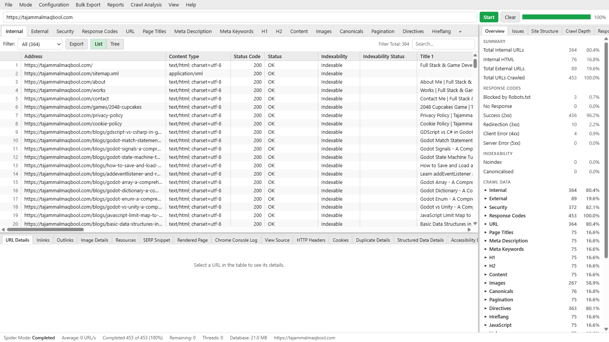
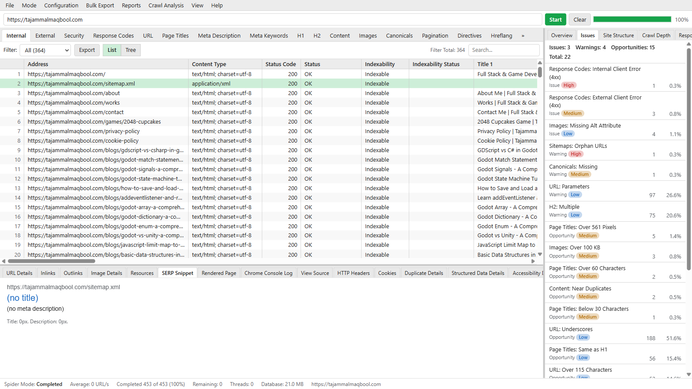
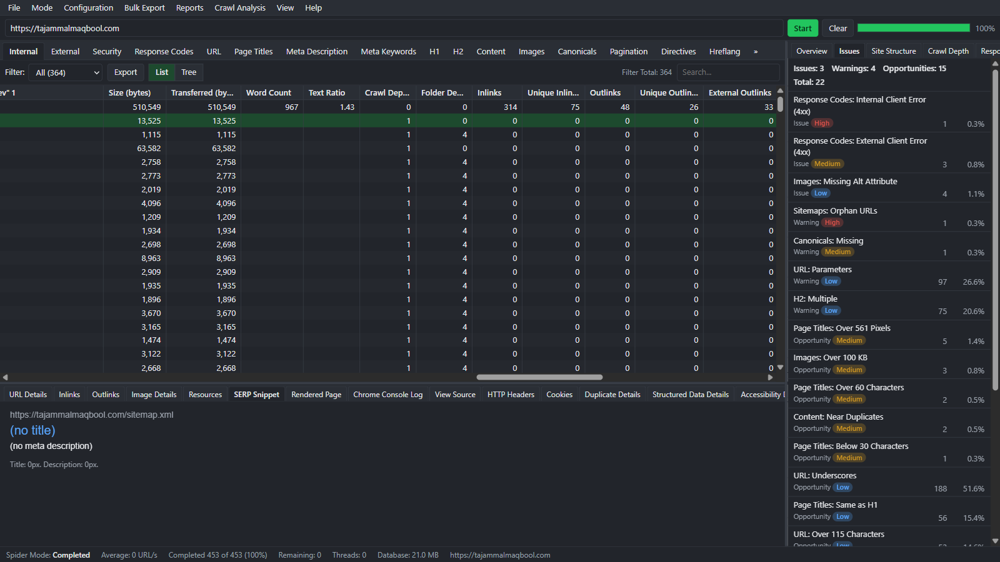

<p align="center">
  
</p>

<p align="center">
  <strong>A fast desktop website crawler for technical SEO audits.</strong><br />
  Crawl a site, find SEO issues, and export the results. All crawl data stays on your computer.
</p>

<p align="center">
  
  
  
  
  
  <a href="LICENSE"></a>
  <a href="https://github.com/Tajammal-Maqbool/crawlwise-spider/releases/latest"></a>
</p>

<p align="center">
  <a href="https://github.com/Tajammal-Maqbool/crawlwise-spider/releases/latest"><strong>Download for Windows</strong></a>
</p>

<p align="center">
  <a href="#download">Download</a> ·
  <a href="#features">Features</a> ·
  <a href="#screenshots">Screenshots</a> ·
  <a href="#getting-started">Getting started</a> ·
  <a href="#command-line">Command line</a> ·
  <a href="#google-search-console-and-ga4">Google setup</a> ·
  <a href="#project-structure">Project structure</a>
</p>

---

## Screenshots

These screenshots show a real crawl of [tajammalmaqbool.com](https://tajammalmaqbool.com): 453 URLs crawled, with issues sorted by priority.



<table>
  <tr>
    <td width="50%"></td>
    <td width="50%"></td>
  </tr>
  <tr>
    <td align="center"><sub>Issues panel, ranked by priority, with the SERP snippet preview</sub></td>
    <td align="center"><sub>Dark theme</sub></td>
  </tr>
</table>

## Download

Get the latest Windows build from the [Releases page](https://github.com/Tajammal-Maqbool/crawlwise-spider/releases/latest).

| File | Use it when |
| --- | --- |
| `Crawlwise-Spider-Setup-<version>.exe` | You want to install the app with Start menu and desktop shortcuts. |
| `Crawlwise-Spider-<version>-portable.exe` | You want to run the app without installing it, for example from a USB drive. Scheduled crawls and the CLI need the installer. |

The builds are not code-signed yet. Windows SmartScreen can show "Windows protected your PC". Click **More info**, then **Run anyway**.

## Features

| Area | What you get |
| --- | --- |
| **Crawling** | Spider mode from a start URL, or List mode from a list of URLs. Robots.txt, sitemaps, redirects and crawl depth. |
| **SEO checks** | Response codes, page titles, meta descriptions, headings, canonicals, directives, hreflang, pagination, images, content and security headers. Each tab has filters for issues. |
| **Issues report** | Issues, warnings and opportunities, ranked by priority, with counts and percentages. |
| **JavaScript rendering** | Render pages in Chromium. Keep screenshots and the Chrome console log. |
| **Accessibility** | axe-core checks on rendered pages. |
| **URL details** | Inlinks, outlinks, resources, SERP snippet, rendered page, HTTP headers, cookies, duplicate content, structured data and page source. |
| **Charts** | Overview, site structure, crawl depth and response times. |
| **Integrations** | Google Search Console, GA4, URL Inspection and PageSpeed Insights. |
| **Compare** | Compare two saved crawls. |
| **Export** | CSV or XLSX for any tab, bulk exports and an issues report. |
| **Automation** | Scheduled crawls with Windows Task Scheduler, and a headless CLI. |
| **Interface** | Light and dark themes. Column layouts are saved for each tab. |

## Getting started

### Requirements

- Node.js and npm. The project is tested with Node.js 24.
- Windows. Scheduling uses Windows Task Scheduler. The other features use Electron, but they are only tested on Windows.

### Install and run

```bash
git clone https://github.com/Tajammal-Maqbool/crawlwise-spider.git
cd crawlwise-spider
npm install
npm run dev
```

Enter a URL in the address bar and click **Start**.

### Scripts

| Command | What it does |
| --- | --- |
| `npm run dev` | Start the app in development mode. |
| `npm run build` | Build the app into `out/`. |
| `npm start` | Run the built app. |
| `npm run typecheck` | Check types with TypeScript. |
| `npm test` | Run unit and integration tests. |
| `npm run test:e2e` | Build the app and run end-to-end tests. |
| `npm run dist` | Build the Windows installer and portable exe into `dist/`. |

## Command line

Run a crawl without the user interface.

**Installed app:** the installer puts `crawlwise-cli.cmd` in the `resources` folder of the install folder. The default install folder is `%LOCALAPPDATA%\Programs\Crawlwise Spider`.

```bat
"%LOCALAPPDATA%\Programs\Crawlwise Spider\resources\crawlwise-cli.cmd" --crawl https://example.com --output-folder .\crawl --export-format xlsx
```

**From source:** build the app first.

```bash
npm run build
npm run cli -- --crawl https://example.com --output-folder ./crawl --export-tabs "page-titles:missing" --export-format xlsx
```

The portable exe has no CLI and cannot run scheduled crawls. Use the installer for those features.

| Option | Description |
| --- | --- |
| `--crawl <url>` | Start URL for Spider mode. |
| `--list <file>` | Text file with one URL per line (List mode). |
| `--config <file.json>` | Crawl configuration JSON. |
| `--output-folder <dir>` | Folder for the crawl database and exports. |
| `--export-tabs <list>` | Comma-separated filter keys to export. |
| `--bulk-export <list>` | Comma-separated bulk export keys. |
| `--export-format <fmt>` | `csv` (default) or `xlsx`. |
| `--list-exports` | Print every filter key and bulk export key. |

The CLI crawls raw HTML. JavaScript rendering, Search Console and GA4 need the desktop app.

## Google Search Console and GA4

You do not need a Google account to crawl. Only the Search Console and GA4 integrations need one. Crawlwise Spider does not ship a shared OAuth client, so you create your own client one time. The client is free.

<details>
<summary><strong>1. Create the OAuth client</strong></summary>

1. Open the Google Cloud console. Select or create a project.
2. In **APIs and Services > Library**, enable these APIs:
   - Google Search Console API
   - Google Analytics Data API
   - Google Analytics Admin API
3. In **Google Auth Platform**, set up the consent screen. Set the audience to **External**. While the app is in **Testing**, add your Google account as a test user.
4. Go to **Clients > Create client**. Select the application type **Desktop app**.
5. Copy the **Client ID** and the **Client secret**.

In **Testing** status, the sign-in expires after 7 days. In **In production** status, it does not expire, but Google shows an "unverified app" warning that you can accept for your own account. Google can change these rules, so check the Google Cloud console.

</details>

<details>
<summary><strong>2. Connect the app</strong></summary>

1. Open **Configuration > API Access**.
2. In **Google Account**, paste the client ID and the client secret.
3. Click **Connect**. Sign in with your browser and allow read access.

The app receives the sign-in on a temporary local address (`http://127.0.0.1:<port>`) and uses PKCE. Do not close the app during the sign-in.

</details>

<details>
<summary><strong>3. Select the properties</strong></summary>

- **Search Console:** click **Load Properties**, select a property, then select **Import Search Console data for this crawl**. You can also crawl new URLs found in Search Console and run URL Inspection. Google allows 2,000 inspections a day for each property.
- **GA4:** click **Load Properties**, select the property, then select **Import GA4 data for this crawl**.

The import runs when the crawl starts. URLs that Search Console or GA4 know about, but that the crawl did not find, are shown as possible orphan pages.

</details>

## Privacy

Crawl data is stored in a local SQLite database on your computer. Google sign-in tokens are encrypted with the operating system's secure storage. The app sends no telemetry.

## Project structure

```
src/
  main/       Electron main process: crawler, database, exports, Google, scheduling
  preload/    Safe bridge between the main process and the UI
  renderer/   React user interface
  shared/     Types, constants and helpers used by all processes
  cli/        Command line entry point
tests/        Unit, integration and end-to-end tests
resources/    App icons
```

## About the author

<table>
  <tr>
    <td>
      <strong>Tajammal Maqbool</strong>, Website &amp; Game Developer<br /><br />
      I'm a software engineer who loves creating web applications and games. I work across the front end and the back end, with JavaScript, TypeScript, React, Node.js and Express. I also build games with Unity, Godot, Phaser 3, Three.js and Babylon.js.<br /><br />
      I studied Computer Science at UET Lahore (2020 to 2024) and have freelanced since 2021, with 10+ jobs on Upwork and 200+ orders on Fiverr.
      <br /><br />
      <a href="https://tajammalmaqbool.com">Website</a> ·
      <a href="https://tajammalmaqbool.com/resume.pdf">Resume</a> ·
      <a href="https://github.com/Tajammal-Maqbool">GitHub</a> ·
      <a href="https://tajammalmaqbool.itch.io">itch.io</a> ·
      <a href="https://patreon.com/TajammalMaqbool">Patreon</a>
    </td>
  </tr>
</table>

## License

Crawlwise Spider is released under the [MIT License](LICENSE). Copyright (c) 2026 Tajammal Maqbool.
